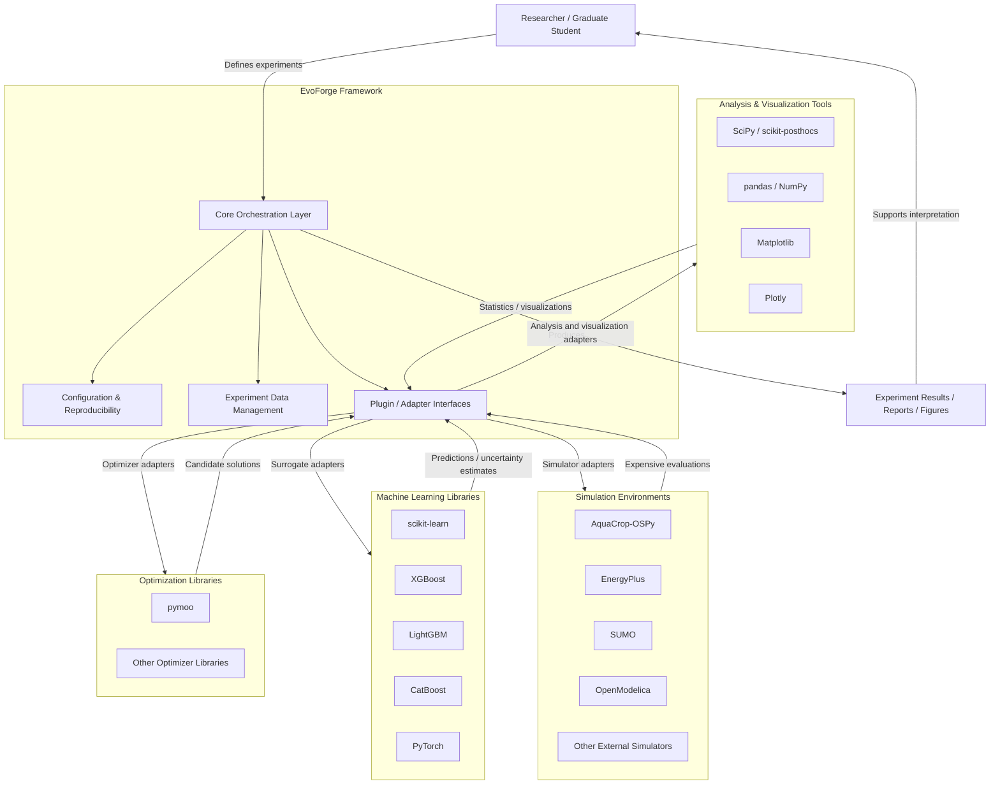

# System Requirements Specification

## Purpose

This document defines the functional and non-functional requirements of EvoForge. It serves as the contractual specification that guides the architecture, implementation, testing, and future evolution of the framework.

---

## Scope

EvoForge is intended to provide a modular and extensible framework for conducting Simulation-Based Optimization (SBO) experiments through the integration of evolutionary algorithms, surrogate models, simulation environments, statistical analysis, visualization, and experiment management.

The framework is designed as a research platform rather than as a domain-specific application. Consequently, its architecture must support multiple optimization paradigms, simulation environments, and machine learning techniques while remaining independent of any particular external library.

---

## Intended Audience

This specification is intended for:

- Software architects
- Framework developers
- Researchers
- Graduate students
- Future contributors

---

## System Context

EvoForge is positioned as a research framework that orchestrates external optimization libraries, machine learning libraries, simulation environments, analysis tools, and visualization tools through a stable plugin-oriented architecture.

The system boundary separates the EvoForge core from external technologies. The core is responsible for experiment orchestration, configuration, reproducibility, data management, and plugin coordination. External libraries and simulators are accessed through plugins or adapters rather than through direct coupling with the core.

The official system context diagram is maintained as a Mermaid source file:

- [`EVF-DGM-0001 -- System Context Diagram`](diagrams/system_context.mmd)

This context establishes that EvoForge does not replace existing scientific libraries. Instead, it provides the integration, reproducibility, data flow, and experiment management layer required to use those tools coherently within simulation-based optimization research.

---

## Functional Requirements

### FR-001 -- Experiment Management

**Description**

The framework shall allow users to define, configure, execute, monitor, and reproduce simulation-based optimization experiments.

**Rationale**

The experiment is the central entity of EvoForge. Every optimization process, simulation, surrogate model, statistical analysis, and report belongs to an experiment.

---

### FR-002 -- Problem Definition

**Description**

The framework shall support the definition of optimization problems independently of the optimization algorithms and simulation environments.

**Rationale**

Problem definitions must remain reusable across different optimizers, simulators, surrogate models, and experimental workflows.

---

### FR-003 -- Simulator Integration

**Description**

The framework shall support the integration of external simulation environments through standardized interfaces.

**Rationale**

Simulation-Based Optimization depends on external simulators that may come from different scientific domains, execution environments, and software ecosystems.

---

### FR-004 -- Evolutionary Optimizers

**Description**

The framework shall support multiple optimization algorithms without requiring modifications to the framework core.

**Rationale**

EvoForge must allow researchers to evaluate and compare different evolutionary algorithms while preserving a stable core architecture.

---

### FR-005 -- Surrogate Models

**Description**

The framework shall support multiple surrogate models through a common abstraction layer.

**Rationale**

Surrogate models are central to reducing the computational cost of expensive simulations and must be interchangeable within experimental workflows.

---

### FR-006 -- Experiment Reproducibility

**Description**

Every experiment shall be reproducible using its stored configuration and random seed.

**Rationale**

Scientific experimentation requires traceability, repeatability, and transparent reporting of all configuration parameters and stochastic elements.

---

### FR-007 -- Data Management

**Description**

The framework shall store all experiment inputs, outputs, evaluations, and metadata.

**Rationale**

Experiment data must be preserved to support surrogate training, statistical analysis, visualization, debugging, reporting, and future reuse.

---

### FR-008 -- Statistical Analysis

**Description**

The framework shall provide standardized statistical analysis for comparing optimization algorithms and surrogate models.

**Rationale**

Research conclusions must be supported by rigorous statistical methods rather than by isolated performance comparisons.

---

### FR-009 -- Visualization

**Description**

The framework shall generate visualizations for experiments, optimization progress, surrogate performance, and statistical analyses.

**Rationale**

Visual outputs help researchers interpret algorithm behavior, surrogate accuracy, convergence patterns, and comparative results.

---

### FR-010 -- Extensibility

**Description**

The framework shall allow researchers to add new optimizers, surrogate models, simulators, and visualization modules without modifying the framework core.

**Rationale**

Long-term sustainability requires EvoForge to evolve through extensions and adapters rather than through changes to its core components.
