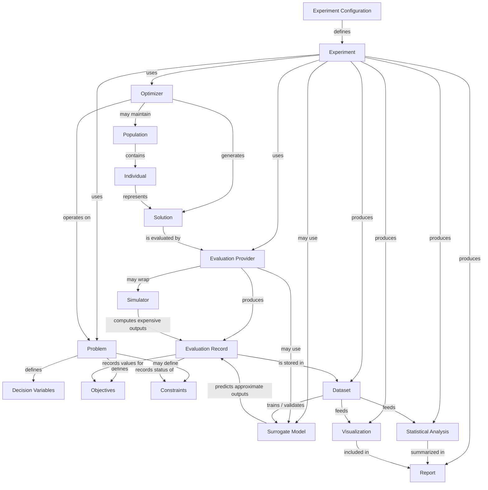

# Domain Model

## Purpose

This document defines the core domain concepts of EvoForge and the relationships between them.

The domain model provides the conceptual foundation for the framework architecture, public API, implementation plan, documentation, and scientific publications.

---

## Scope

This document describes the main entities that exist in EvoForge from a research and software architecture perspective.

It does not define Python classes, method signatures, package structure, database schemas, or implementation details. Those elements will be specified later in the architecture and API design documents.

---

## Domain Overview

EvoForge is centered on the concept of an `Experiment`.

An experiment coordinates a simulation-based optimization workflow by combining a problem definition, an optimization algorithm, one or more simulation or evaluation mechanisms, optional surrogate models, data management, statistical analysis, visualization, and reporting.

At the domain level, EvoForge is not defined by any specific external library. Libraries such as `pymoo`, `scikit-learn`, XGBoost, LightGBM, CatBoost, Plotly, and AquaCrop-OSPy are treated as external technologies that can be integrated through plugins or adapters.

---

## Domain Model Diagram

The official domain model diagram is maintained as a Mermaid source file:

- [`EVF-DGM-0002 -- Domain Model Diagram`](diagrams/domain_model.mmd)

---

## Core Domain Entities

### EVF-TERM-001 -- Experiment

An `Experiment` is the central unit of execution and reproducibility in EvoForge.

It defines what will be optimized, how it will be optimized, how evaluations will be performed, which surrogate models may be used, how data will be stored, and how results will be analyzed.

Relationships:

- Uses one or more `Problem` definitions.
- Uses one or more `Optimizer` components.
- Uses one or more `Evaluation Provider` components.
- May use one or more `Surrogate Model` components.
- Produces `Evaluation Records`, `Datasets`, `Statistics`, `Visualizations`, and `Reports`.
- Is configured by an `Experiment Configuration`.

Related requirements:

- FR-001 -- Experiment Management
- FR-006 -- Experiment Reproducibility
- FR-007 -- Data Management

---

### EVF-TERM-002 -- Problem

A `Problem` defines the optimization task to be solved.

It specifies the decision variables, objectives, constraints, search space, and domain-specific meaning of candidate solutions.

Relationships:

- Defines `Decision Variables`.
- Defines one or more `Objectives`.
- May define `Constraints`.
- Receives candidate `Solutions`.
- Is evaluated through an `Evaluation Provider`.

Related requirements:

- FR-002 -- Problem Definition

---

### EVF-TERM-003 -- Decision Variable

A `Decision Variable` is an input parameter that can be modified by an optimizer.

Decision variables define the search space of a problem and may be continuous, discrete, categorical, integer-valued, binary, or structured.

Relationships:

- Belongs to a `Problem`.
- Is assigned a value within a `Solution`.
- May have bounds, allowed values, units, or domain-specific metadata.

Related requirements:

- FR-002 -- Problem Definition

---

### EVF-TERM-004 -- Objective

An `Objective` defines a quantity that must be minimized, maximized, or otherwise optimized.

Examples may include crop yield, water use, cost, energy consumption, error, risk, or computational time.

Relationships:

- Belongs to a `Problem`.
- Is computed from an `Evaluation`.
- May be part of a single-objective or multi-objective optimization problem.

Related requirements:

- FR-002 -- Problem Definition

---

### EVF-TERM-005 -- Constraint

A `Constraint` defines a condition that candidate solutions must satisfy.

Constraints may represent physical limits, feasibility rules, simulation restrictions, agronomic requirements, budget limits, or domain-specific validity conditions.

Relationships:

- Belongs to a `Problem`.
- Is checked during or after an `Evaluation`.
- May affect solution feasibility, ranking, or selection.

Related requirements:

- FR-002 -- Problem Definition

---

### EVF-TERM-006 -- Solution

A `Solution` is a concrete assignment of values to the decision variables of a problem.

It represents a candidate configuration that can be evaluated by a simulator, surrogate model, analytical function, or other evaluation mechanism.

Relationships:

- Instantiates the `Decision Variables` of a `Problem`.
- May belong to an `Individual` in population-based optimization.
- Produces one or more `Evaluation Records`.

Related requirements:

- FR-001 -- Experiment Management
- FR-002 -- Problem Definition

---

### EVF-TERM-007 -- Evaluation Provider

An `Evaluation Provider` is any component capable of evaluating a solution.

In EvoForge, evaluations may be performed by an external simulator, a surrogate model, a benchmark function, or a hybrid evaluation strategy.

Relationships:

- Receives a `Solution`.
- Produces an `Evaluation Record`.
- May wrap a `Simulator`, `Surrogate Model`, or analytical evaluator.

Related requirements:

- FR-003 -- Simulator Integration
- FR-005 -- Surrogate Models

---

### EVF-TERM-008 -- Simulator

A `Simulator` is an external or internal system that computes objective values, constraints, or domain-specific outputs from a candidate solution.

Simulators may be expensive, slow, stochastic, domain-specific, or dependent on external files and execution environments.

Relationships:

- Is accessed through an `Evaluation Provider`.
- Produces simulation outputs used by `Evaluation Records`.
- Is integrated through a plugin or adapter.

Related requirements:

- FR-003 -- Simulator Integration
- FR-010 -- Extensibility

---

### EVF-TERM-009 -- Evaluation Record

An `Evaluation Record` stores the result of evaluating a solution.

It captures the input solution, objective values, constraint values, metadata, evaluation source, timestamps, execution status, and any relevant simulator or surrogate outputs.

Relationships:

- Belongs to an `Experiment`.
- References a `Solution`.
- Is produced by an `Evaluation Provider`.
- Becomes part of a `Dataset`.

Related requirements:

- FR-006 -- Experiment Reproducibility
- FR-007 -- Data Management

---

### EVF-TERM-010 -- Dataset

A `Dataset` is a structured collection of evaluation records used for analysis, surrogate training, validation, reporting, and reproducibility.

Relationships:

- Is produced by an `Experiment`.
- Contains `Evaluation Records`.
- May be used to train or validate `Surrogate Models`.
- May be analyzed by `Statistical Analysis` components.

Related requirements:

- FR-005 -- Surrogate Models
- FR-007 -- Data Management
- FR-008 -- Statistical Analysis

---

### EVF-TERM-011 -- Surrogate Model

A `Surrogate Model` is an approximation model trained to estimate the behavior of an expensive simulator or evaluation process.

Examples include Random Forest, Gradient Boosting, Gaussian Process Regression, Support Vector Regression, Multi-Layer Perceptrons, and other regression or uncertainty-aware models.

Relationships:

- Is trained using a `Dataset`.
- Predicts objective values, constraints, uncertainty, or other outputs.
- May act as an `Evaluation Provider`.
- Is integrated through a plugin or adapter.

Related requirements:

- FR-005 -- Surrogate Models
- FR-010 -- Extensibility

---

### EVF-TERM-012 -- Optimizer

An `Optimizer` generates, selects, modifies, and improves candidate solutions according to an optimization strategy.

In EvoForge, optimizers may include evolutionary algorithms, swarm intelligence methods, derivative-free optimizers, or other search methods.

Relationships:

- Operates on a `Problem`.
- Generates `Solutions`.
- Requests evaluations from an `Evaluation Provider`.
- May maintain a `Population`.
- Is integrated through a plugin or adapter.

Related requirements:

- FR-004 -- Evolutionary Optimizers
- FR-010 -- Extensibility

---

### EVF-TERM-013 -- Individual

An `Individual` is a population-based optimization representation of a candidate solution.

It may contain a solution, objective values, constraint values, fitness information, rank, metadata, or algorithm-specific attributes.

Relationships:

- Contains or references a `Solution`.
- May belong to a `Population`.
- May be created, modified, selected, or discarded by an `Optimizer`.

Related requirements:

- FR-004 -- Evolutionary Optimizers

---

### EVF-TERM-014 -- Population

A `Population` is a collection of individuals managed by a population-based optimizer.

Relationships:

- Contains `Individuals`.
- Evolves across optimization iterations or generations.
- Is managed by an `Optimizer`.

Related requirements:

- FR-004 -- Evolutionary Optimizers

---

### EVF-TERM-015 -- Experiment Configuration

An `Experiment Configuration` is a complete declarative description of an experiment.

It includes problem settings, optimizer settings, simulator or evaluator settings, surrogate model settings, random seeds, execution parameters, output paths, and reproducibility metadata.

Relationships:

- Defines an `Experiment`.
- Configures `Problems`, `Optimizers`, `Evaluation Providers`, `Simulators`, `Surrogate Models`, and output behavior.
- Supports reproducibility and traceability.

Related requirements:

- FR-001 -- Experiment Management
- FR-006 -- Experiment Reproducibility

---

### EVF-TERM-016 -- Statistical Analysis

`Statistical Analysis` refers to the methods used to compare experimental results, optimization algorithms, surrogate models, and strategies.

It may include descriptive statistics, hypothesis tests, ranking methods, post-hoc comparisons, confidence intervals, and effect size measures.

Relationships:

- Consumes `Datasets` and experiment results.
- Produces statistical summaries and comparative evidence.
- Supports scientific conclusions and publications.

Related requirements:

- FR-008 -- Statistical Analysis

---

### EVF-TERM-017 -- Visualization

A `Visualization` is a graphical representation of experiment behavior, optimization progress, surrogate performance, statistical comparisons, or final results.

Relationships:

- Consumes `Evaluation Records`, `Datasets`, `Statistics`, and experiment metadata.
- Produces figures, plots, dashboards, or report-ready images.

Related requirements:

- FR-009 -- Visualization

---

### EVF-TERM-018 -- Report

A `Report` is a structured output that summarizes experiment configuration, execution, results, statistics, visualizations, and reproducibility metadata.

Relationships:

- Belongs to an `Experiment`.
- Uses `Datasets`, `Statistics`, and `Visualizations`.
- Supports interpretation, auditability, thesis writing, and scientific publication.

Related requirements:

- FR-001 -- Experiment Management
- FR-007 -- Data Management
- FR-008 -- Statistical Analysis
- FR-009 -- Visualization

---

## Conceptual Relationships

The following relationships summarize the domain model at a high level:

- An `Experiment` is configured by an `Experiment Configuration`.
- An `Experiment` uses one or more `Problems`.
- A `Problem` defines `Decision Variables`, `Objectives`, and optional `Constraints`.
- An `Optimizer` generates candidate `Solutions` for a `Problem`.
- A `Solution` is evaluated by an `Evaluation Provider`.
- An `Evaluation Provider` may use a `Simulator`, `Surrogate Model`, benchmark function, or hybrid evaluation strategy.
- An evaluation produces an `Evaluation Record`.
- `Evaluation Records` are stored in `Datasets`.
- `Datasets` may be used to train `Surrogate Models`.
- `Datasets` and experiment outputs are consumed by `Statistical Analysis` and `Visualization` components.
- `Reports` summarize configurations, results, statistics, visualizations, and reproducibility metadata.

---

## Domain Boundary

The EvoForge domain includes the concepts required to define, execute, trace, analyze, and report simulation-based optimization experiments.

The following elements are considered external to the EvoForge domain and should be integrated through plugins or adapters:

- Concrete optimization libraries such as `pymoo`
- Concrete machine learning libraries such as `scikit-learn`, XGBoost, LightGBM, CatBoost, or PyTorch
- Concrete simulation environments such as AquaCrop-OSPy, EnergyPlus, SUMO, or OpenModelica
- Concrete plotting or dashboard libraries such as Matplotlib or Plotly
- External storage systems, workflow managers, or compute environments

---

## Open Questions

- Should an `Experiment` support multiple optimizers in a single execution, or should comparisons be represented as separate experiments?
- Should a `Surrogate Model` always be treated as an `Evaluation Provider`, or should it be modeled as a separate component used by an evaluation strategy?
- Should `Dataset` be immutable once produced by an experiment?
- Should `Report` be part of the core domain or implemented as an extension module?
- How should uncertainty estimates from surrogate models be represented in the domain model?
- How should multi-objective and constrained optimization metadata be standardized across different optimizer libraries?

---

## References

- `docs/00_Project_Vision.md`
- `docs/01_Project_Principles.md`
- `docs/02_System_Requirements.md`
- `docs/04_Architecture_Decisions/ADR-0001-plugin-first.md`
