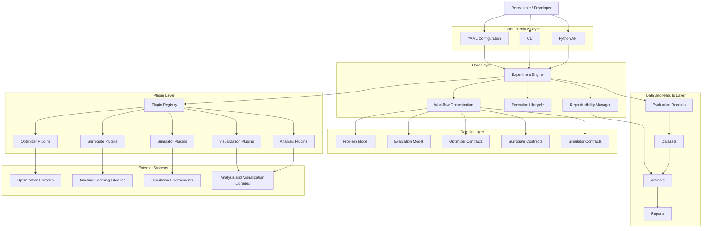
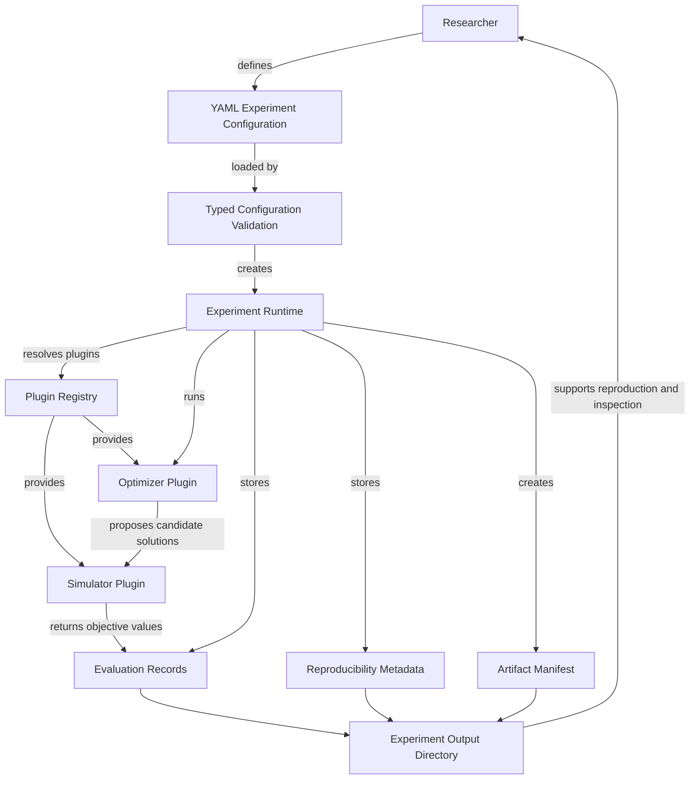

# Architecture Overview

## Purpose

This document defines the high-level software architecture of EvoForge.

It translates the project vision, principles, system requirements, domain model, and architectural decisions into a logical architecture that can guide API design and implementation.

---

## Scope

This document describes the main architectural layers, responsibilities, dependency direction, and extension points of EvoForge.

It does not define Python package structure, class signatures, method names, concrete dependencies, or implementation details. Those elements will be specified in the API design and implementation plan documents.

---

## Architectural Style

EvoForge follows a modular, plugin-first, layered architecture.

The architecture separates the framework core from concrete external technologies. The core defines orchestration behavior, domain abstractions, configuration handling, reproducibility mechanisms, and plugin coordination. Concrete integrations with optimization libraries, machine learning libraries, simulators, statistical tools, and visualization tools are implemented outside the core through plugins or adapters.

This architectural style is derived from:

- Principle 1 -- Plugin-First Architecture
- Principle 2 -- Integration over Reinvention
- Principle 3 -- Reproducibility First
- Principle 4 -- Separation of Concerns
- ADR-0001 -- Plugin-First Architecture
- ADR-0002 -- Configuration Management

---

## Architecture Overview Diagram

The official architecture overview diagram is maintained as a Mermaid source file:

- [`EVF-DGM-0003 -- Architecture Overview Diagram`](diagrams/architecture_overview.mmd)



---

## Experiment Workflow Diagram

The official experiment workflow diagram is maintained as a Mermaid source file:

- [`EVF-DGM-0004 -- Experiment Workflow Diagram`](diagrams/experiment_workflow.mmd)



This workflow represents the current MVP execution path. It demonstrates how a researcher-defined YAML configuration becomes a validated experiment, how the runtime resolves plugins through the registry, and how EvoForge stores evaluation and reproducibility artifacts.

---

## Architectural Layers

### User Interface Layer

The User Interface Layer defines how researchers and developers interact with EvoForge.

Initial access modes include:

- Python API for programmatic experiment definition.
- Command-line interface for running configured experiments.
- YAML configuration files for reproducible experiment specification.

This layer should remain thin. It should translate user intent into validated experiment definitions and delegate execution to the Core Layer. YAML configurations shall be validated through typed configuration models before execution.

Related requirements:

- FR-001 -- Experiment Management
- FR-006 -- Experiment Reproducibility

---

### Core Layer

The Core Layer coordinates experiment execution.

It is responsible for:

- Experiment lifecycle management.
- Workflow orchestration.
- Configuration loading and validation.
- Reproducibility metadata.
- Coordination between domain entities, plugins, and data storage.
- Error handling and execution state tracking.

The Core Layer must not directly depend on concrete external libraries such as `pymoo`, `scikit-learn`, XGBoost, LightGBM, CatBoost, Plotly, or AquaCrop-OSPy.

Related requirements:

- FR-001 -- Experiment Management
- FR-006 -- Experiment Reproducibility
- FR-007 -- Data Management

---

### Domain Layer

The Domain Layer defines the stable concepts and contracts of EvoForge.

It includes abstractions for:

- Problems
- Decision variables
- Objectives
- Constraints
- Solutions
- Evaluation providers
- Optimizers
- Simulators
- Surrogate models
- Datasets
- Reports

The Domain Layer represents EvoForge's internal language and must remain independent of concrete third-party implementations.

Related requirements:

- FR-002 -- Problem Definition
- FR-003 -- Simulator Integration
- FR-004 -- Evolutionary Optimizers
- FR-005 -- Surrogate Models

---

### Plugin Layer

The Plugin Layer contains concrete integrations with external tools.

Examples include:

- `pymoo` optimizer adapters.
- `scikit-learn` surrogate model adapters.
- XGBoost, LightGBM, and CatBoost surrogate adapters.
- AquaCrop-OSPy simulator adapters.
- Matplotlib and Plotly visualization adapters.
- SciPy and scikit-posthocs statistical analysis adapters.

Plugins must conform to the contracts defined by the Domain Layer and be discovered, registered, configured, and executed through core mechanisms.

Related requirements:

- FR-003 -- Simulator Integration
- FR-004 -- Evolutionary Optimizers
- FR-005 -- Surrogate Models
- FR-008 -- Statistical Analysis
- FR-009 -- Visualization
- FR-010 -- Extensibility

---

### Data and Results Layer

The Data and Results Layer stores and organizes experiment outputs.

It is responsible for:

- Evaluation records.
- Generated datasets.
- Trained surrogate model artifacts.
- Experiment metadata.
- Statistical outputs.
- Visualizations.
- Reports.

This layer supports reproducibility, traceability, analysis, and publication-ready reporting.

Related requirements:

- FR-006 -- Experiment Reproducibility
- FR-007 -- Data Management
- FR-008 -- Statistical Analysis
- FR-009 -- Visualization

---

## Dependency Direction

EvoForge dependencies should point inward toward stable abstractions.

The Core Layer may depend on the Domain Layer and plugin contracts. Plugins may depend on external libraries and implement EvoForge contracts. The Domain Layer must not depend on concrete plugins or external libraries.

The intended dependency direction is:

```text
User Interface Layer
        |
        v
Core Layer
        |
        v
Domain Layer
        ^
        |
Plugin Layer ---> External Libraries and Simulators
```

This dependency direction protects the framework core from changes in external libraries and enables long-term extensibility.

---

## Architectural Responsibilities

| Responsibility | Primary Layer |
| --- | --- |
| Define experiments | User Interface Layer |
| Validate configurations | Core Layer |
| Orchestrate execution | Core Layer |
| Define stable contracts | Domain Layer |
| Integrate external libraries | Plugin Layer |
| Store evaluation records | Data and Results Layer |
| Train surrogate adapters | Plugin Layer |
| Run simulator adapters | Plugin Layer |
| Produce statistics and figures | Plugin Layer / Data and Results Layer |
| Preserve reproducibility metadata | Core Layer / Data and Results Layer |

---

## Initial Architectural Constraints

- The core shall not directly import concrete optimization, machine learning, simulation, or visualization libraries.
- All concrete integrations shall be implemented through plugins or adapters.
- Experiment execution shall be configuration-driven and reproducible.
- Domain concepts shall be stable before implementation begins.
- Diagrams shall be maintained as Mermaid source files.
- Major architectural decisions shall be documented as ADRs.

---

## Open Questions

- Should the plugin registry support runtime discovery, explicit registration, or both?
- Should configuration validation live entirely in the Core Layer or be partially delegated to plugins?
- Should reports be generated by the Core Layer or by reporting plugins?
- Should the first implementation support only local execution, or should distributed execution be considered early?
- Should the data layer initially use files only, or define an abstraction that later supports databases?

---

## References

- `docs/00_Project_Vision.md`
- `docs/01_Project_Principles.md`
- `docs/02_System_Requirements.md`
- `docs/03_Domain_Model.md`
- `docs/04_Architecture_Decisions/ADR-0001-plugin-first.md`
