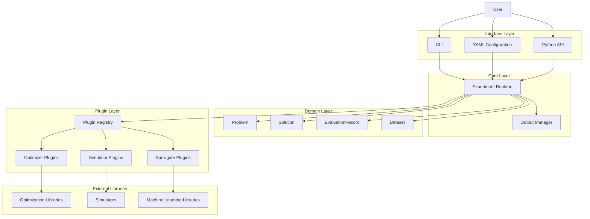

# Architecture

EvoForge is organized around a small set of independent layers.



---

## Core Boundary

The core runtime coordinates configuration loading, plugin lookup, experiment
execution, and output artifact generation.

External scientific libraries are integrated through adapter packages. The core
does not import optional dependencies such as `pymoo` or `scikit-learn`
directly.

---

## Data Flow

The executable experiment flow is:

```text
YAML configuration
    -> validated configuration
    -> domain objects
    -> plugin registry
    -> optimizer and evaluator
    -> evaluation records
    -> output artifacts
```

This keeps experiment definition, execution, evaluation provenance, and output
storage separated.
